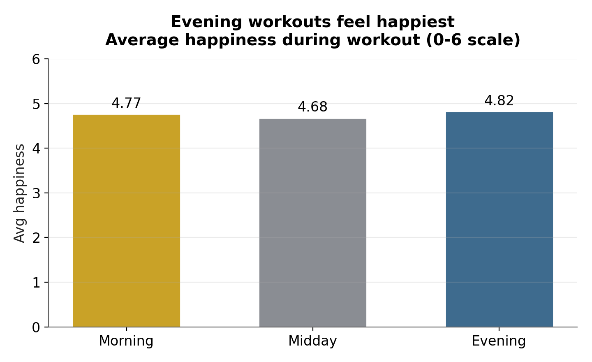
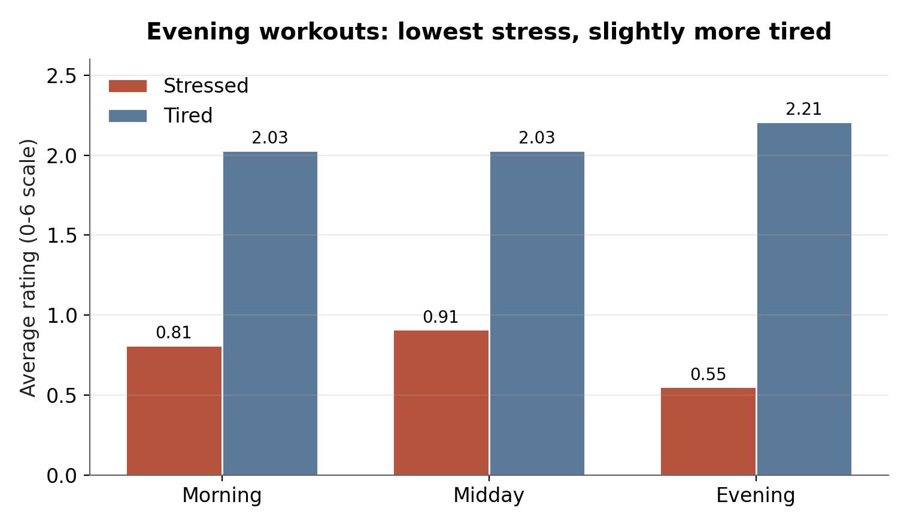
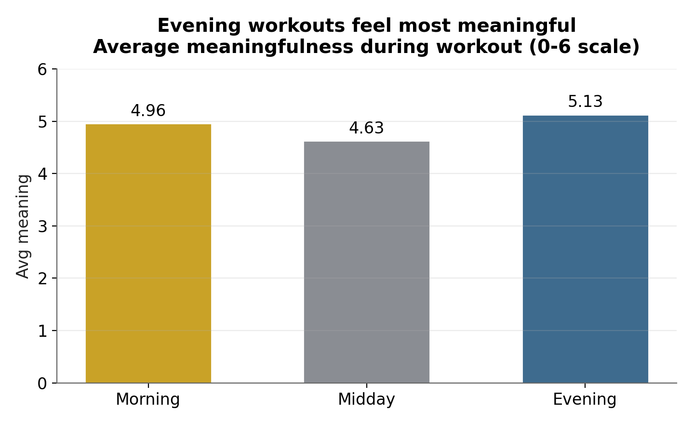
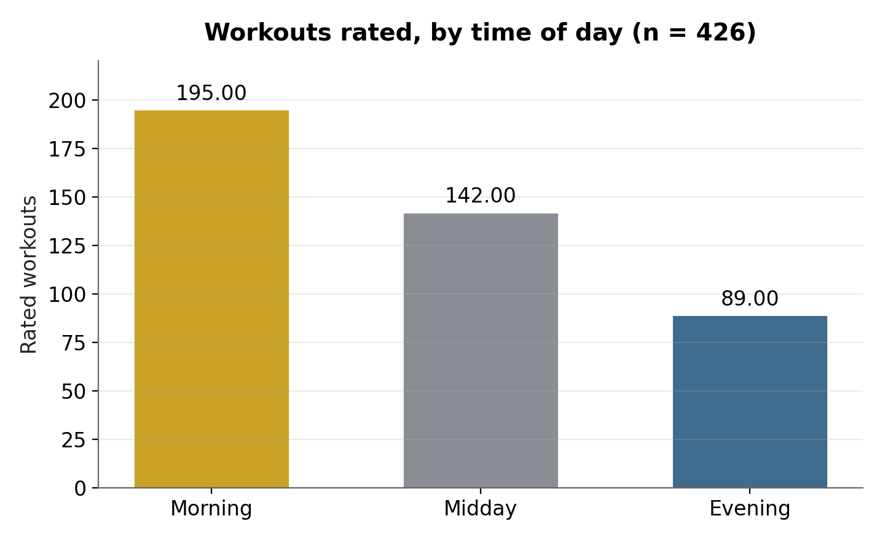
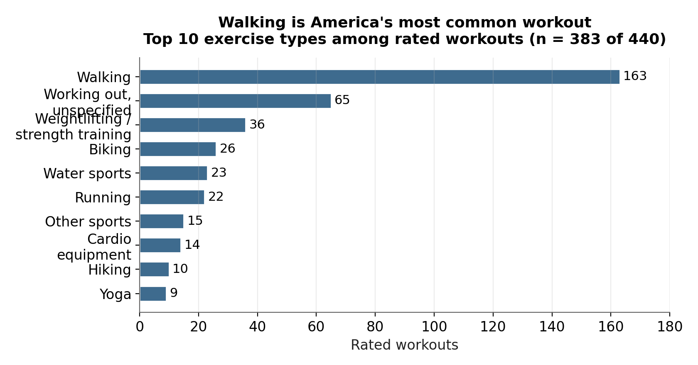

# Does Workout Time of Day Affect How You Feel?

**Merit America / Google Data Analytics Capstone Project**

## The Question

Does the time of day a person exercises relate to how they feel during that exercise — their happiness, stress, tiredness, sadness, pain, and sense of meaning?

## Data Sources

- **American Time Use Survey (ATUS) 2021 Activity file** — U.S. Bureau of Labor Statistics. Activity codes and start times for 164,581 diary activities. [BLS ATUS 2021 microdata](https://www.bls.gov/tus/data/datafiles-2021.htm)
- **ATUS 2021 Well-Being Module, Activity file** — feelings ratings (0–6 scale) collected for up to 3 activities per respondent: happy, stressed, tired, sad, pain, meaning, plus an interact rating. [BLS Well-Being Module 2021](https://www.bls.gov/tus/data/wbdatafiles-2021.htm)
- Activity labels from the [ATUS Activity Coding Lexicon](https://www.bls.gov/tus/lexicons/lexiconnoex0322.pdf).

The two files were joined on respondent ID (`TUCASEID`) and activity number (`TUACTIVITY_N`).

## Process (Ask → Prepare → Process → Analyze → Share → Act)

1. **Prepare:** The BLS files download as `.dat` files that are actually CSV-formatted; they were verified (consistent column counts on every row) and renamed to `.csv` for upload to BigQuery.
2. **Process:** In BigQuery, exercise activities (activity codes 130100–130299) with valid happiness ratings (0–6) were kept, and each workout's start time was bucketed: **Morning** 5:00–11:59, **Midday** 12:00–16:59, **Evening** 17:00–21:59, **Other** overnight. `TUSTARTTIM` loads as a TIME type, so the hour was taken with `EXTRACT(HOUR FROM ...)`. See `sql/01_cleanup_and_join.sql`.
3. **Validate:** Bucket counts were checked against an independent run of the same logic (see `sql/02_validation_counts.sql`).
4. **Analyze:** Feelings were averaged per time bucket with sample sizes (`sql/03_answers_by_time_bucket.sql`), and the most common exercise types were counted (`sql/04_top_exercises.sql`).

## Key Findings

Of 2,701 exercise activities in the data, **440 had feelings ratings** (the Well-Being Module rates only 3 activities per person): Morning 195, Midday 142, Evening 89, Other (overnight) 14. Headline results use the three main buckets (n = 426).

| Time of day | Workouts | Happy | Stressed | Tired | Sad | Pain | Meaning |
|---|---|---|---|---|---|---|---|
| Morning | 195 | 4.77 | 0.81 | 2.03 | 0.29 | 1.06 | 4.96 |
| Midday | 142 | 4.68 | 0.91 | 2.03 | 0.46 | 1.02 | 4.63 |
| Evening | 89 | **4.82** | **0.55** | 2.21 | **0.22** | **0.85** | **5.13** |

- **Evening workouts feel best overall** — highest happiness and meaning, lowest stress, sadness, and pain.
- **Morning is a close second** on every measure, and people reported feeling slightly less tired than in the evening.
- **Midday workouts trail** — lowest happiness and meaning, highest stress and sadness.
- **Walking is America's most common workout:** 163 of the 440 rated workouts (37%) were walking, ahead of unspecified workouts (65) and weightlifting/strength training (36).

## Limitations

- **Correlation, not causation.** People who choose evening workouts may differ from morning exercisers in ways this data can't separate from the workout time itself.
- **Small evening sample** (n = 89) and small differences (happiness range 4.68–4.82 on a 0–6 scale) — the pattern is consistent across measures but modest.
- Feelings were rated **during the activity**, not across the rest of the day.
- These two files contain no day-of-week variable and no clean same-night sleep measure, so weekday-vs-weekend and sleep questions are left as future work.
- Findings describe associations in 2021 U.S. diary data and should not be read as personal health advice.

## Recommendation

For someone deciding when to exercise, the data mildly favors **evening or morning** over midday for mood and stress. The differences are small, so the best time is still the time a person will actually keep — consistency beats a 0.14-point happiness gap.

## Tools

BigQuery (SQL), Looker Studio, GitHub.

## Files in this repo

- `sql/` — the full query set, in run order: cleanup/join, validation counts, answers table, top exercises.
- `charts/` — chart images used above.
